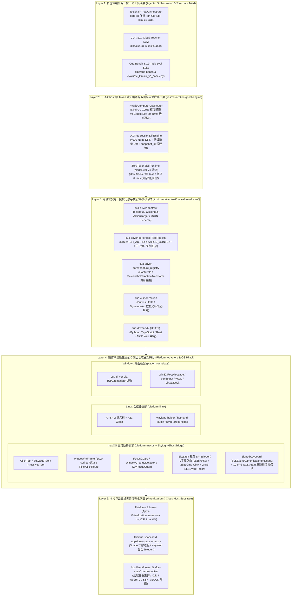
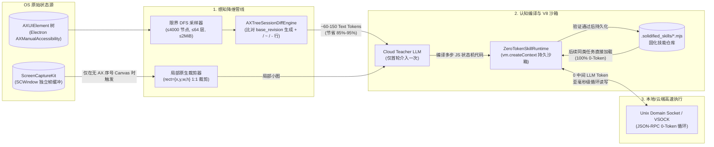
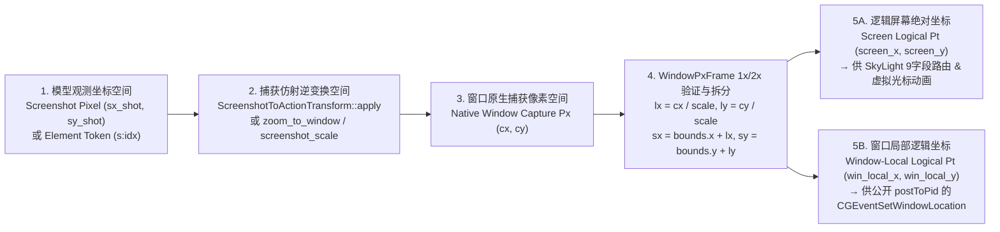
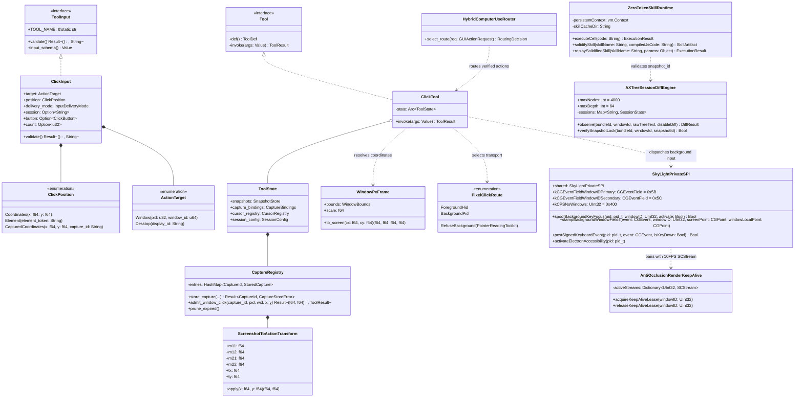
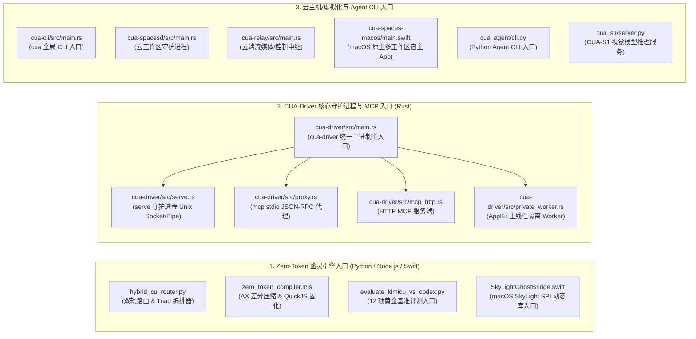

# TopSun-CUA (`CUA-Ghost`) 全仓系统架构图、数据流图（DFD/时序图）与 UML 设计规约

本文档对 [`topsun-cua`](../README.md) 仓库进行全栈软件工程建模，涵盖：
1. **五层全域系统架构图（System Architecture Diagram）**
2. **核心数据流图（Data Flow Diagrams, DFD Layer 0 / Layer 1）与端到端交互时序图（Sequence Diagram）**
3. **核心模块 UML 类图（Class Diagram）与并发状态机图（State Machine Diagram）**

---

## 一、 全仓五层系统架构图（System Architecture）

`topsun-cua` 采用 **“上层零 Token 认知编译 + 中层强契约跨语言安全门禁 + 底层 OS 合成器无感劫持 + 跨平台云主机虚拟化底座”** 的五层解耦架构：



---

## 二、 核心数据流图（Data Flow Diagrams & Sequence Diagrams）

### 2.1 数据流图一：零 Token 感知差分 $\rightarrow$ 动作编译 $\rightarrow$ 固化技能回放闭环（DFD）

展示数据如何从 OS 原始帧缓冲与无障碍树，经过三级数据压缩，将单步 `2,400+ Vision Tokens` 降维至 `60~150 Diff Tokens` 乃至 `0 Token` 本地回放：



### 2.2 数据流图二：多模态坐标空间逆变换流水线（Coordinate Transformation Pipeline）

展示一次点击请求中的坐标数据如何在 **5 个几何空间** 之间流转与验证：



### 2.3 端到端交互时序图（Sequence Diagram：后台窗口点击完整流转）

```mermaid
sequenceDiagram
    autonumber
    participant Agent as Agent / NodeRepl Sandbox
    participant Router as HybridComputerUseRouter
    participant Core as ToolRegistry & ActionTarget
    participant Click as ClickTool (platform-macos)
    participant Frame as CaptureRegistry & WindowPxFrame
    participant Guard as FocusGuard & WindowChangeDetector
    participant Sky as SkyLight / mouse.rs / SkyLightGhostBridge
    participant Target as 目标后台窗口 (Chrome / Feishu)

    Agent->>Router: 发起点击请求 (pid, window_id, x, y, capture_id / snapshot_id)
    Router->>Router: 判定通道 (多窗口/Canvas → Kimi-CU 精确通道; 单窗口原生连点 → Sky IPC)
    Router->>Core: 调用 ToolRegistry::invoke("click", args)
    Core->>Core: normalize_action_target(args) & enforce_delivery_target()
    Core->>Click: ClickTool::invoke(normalized_args)

    alt 携带 capture_id / x, y 像素路径
        Click->>Frame: admit_window_click(capture_id, pid, wid, cx, cy)
        Frame-->>Click: 返回逆变换后的窗口原生像素 (cx, cy)
        Click->>Frame: px_frame::resolve_or_refuse(wid)
        Frame->>Frame: 实时截取 PNG 校验 1x/2x Retina scale (±0.03)
        Frame-->>Click: 返回 (screen_x, screen_y, win_local_x, win_local_y)
        Click->>Click: 校验 0 <= lx <= width 且非 Chromium <select>
    else 携带 element_token 语义路径
        Click->>Click: snapshots.resolve(pid) → element_screen_center(el)
    end

    Click->>Click: gate_background_window_action(pid, wid) 获取进程级互斥租约
    Click->>Sky: element_at_screen_position(pid, screen_x, screen_y) 尝试后台 AXPress 捷径
    alt AX 捷径未命中，进入后台像素路由 (PixelClickRoute::BackgroundPid)
        Click->>Guard: WindowChangeDetector::snapshot_allowing_activation(prior_front, pid)
        Click->>Guard: key_focus_guard::protect(pid) 锁定用户当前 Key Window
        Click->>Sky: prepare_background_pixel_click(pid, wid)
        Sky->>Target: SLPSPostEventRecordTo(248字节 SLSEventRecord, 0x0d) + kCPSNoWindows(0x400)
        Click->>Sky: click_at_xy_with_window_local (Chromium 5步序列)
        Sky->>Target: 1. Move(screen_target, f0=2) → 2. Down/Up(-1,-1, f0=1/2) → 3. Down/Up(screen_target, f0=3/3)<br/>烙印 f40=pid, f51/f91/f92=wid, f58=clickGroupID, 顶部28pt加 Cmd 掩码
        Click->>Guard: restore_user_focus_after_background_pixel() 恢复用户前台焦点
    end
    Click->>Guard: finish_window_observation(snapshot) 汇总窗口变化与读回结果
    Click-->>Agent: 返回 ToolResult { ok, path, verified, effect }
```

---

## 三、 核心模块 UML 设计图（Class Diagram & State Machine Diagram）

### 3.1 全栈核心类图（UML Class Diagram）



### 3.2 鼠标点击与并发快照锁状态机图（UML State Diagram）

```mermaid
stateDiagram-v2
    [*] --> Idle

    Idle --> Observed : get_window_state / get_app_state<br/>签发 snapshot_id & capture_id
    Observed --> ValidatingTarget : 收到 click 请求<br/>normalize_action_target()

    state ValidatingTarget {
        [*] --> CheckLock
        CheckLock --> LockRejected : snapshot_id 或 capture_id 过期/不匹配
        CheckLock --> CheckGeometry : 快照锁通过
        CheckGeometry --> GeometryRejected : WindowNotFound / FrameMismatch (非 1x/2x)<br/>或局部坐标越界 (lx < 0 || lx > width)
        CheckGeometry --> CheckSelectGuard : 几何校验通过
        CheckSelectGuard --> SelectRejected : 后台点击 Chromium <select> (防弹窗提权)
        CheckSelectGuard --> TargetAdmitted : 通过 gate_background_window_action 互斥门禁
    }

    LockRejected --> [*] : 返回 stale_snapshot / invalid_capture 错误 (Fail-Closed)
    GeometryRejected --> [*] : 返回 px_frame_mismatch / out_of_bounds 错误
    SelectRejected --> [*] : 返回 select_menu_would_raise_window (引导改用 set_value)

    TargetAdmitted --> AXSemanticPath : 寻址为 element_token<br/>或像素点命中 AXUIElement (AXPress)
    TargetAdmitted --> SkyIPCBurstPath : HybridRouter 判定为单窗口稳定原生连点
    TargetAdmitted --> BackgroundPixelPath : 无 AX 序号的 Canvas / Web / 多窗口像素点击
    TargetAdmitted --> ForegroundHIDPath : delivery_mode == "foreground" 或 scope == "desktop"

    AXSemanticPath --> ReadbackVerification : AXUIElementPerformAction("AXPress")
    SkyIPCBurstPath --> Completed : SkyComputerUseService 30-40ms 极速派发

    state BackgroundPixelPath {
        [*] --> FocusPrologue
        FocusPrologue --> ChromiumFiveStepStream : SLPSPostEventRecordTo (248B 0x0d)<br/>+ SLPSSetFrontProcessWithOptions(kCPSNoWindows=0x400)
        ChromiumFiveStepStream --> RestoreUserKeyFocus : 1. Move(target) → 2. Down/Up(-1,-1)<br/>→ 3. Down/Up(target, 9字段烙印 + 28pt Cmd保护)
        RestoreUserKeyFocus --> [*] : restore_user_focus_after_background_pixel()
    }

    BackgroundPixelPath --> ReadbackVerification
    ForegroundHIDPath --> ReadbackVerification : CGDisplay::warp + HID Tap + 恢复原前台进程

    state ReadbackVerification {
        [*] --> PollAXState
        PollAXState --> VerifiedConfirmed : Toggle/Row AXValue 或 AXSelected 改变并稳定 250ms
        PollAXState --> SuspectedNoop : 元素未声明 AXPress 且无状态变化 (建议切换 px)
        PollAXState --> UnverifiableDelivered : 像素点击已投递，交由下次差分观测确认
    }

    VerifiedConfirmed --> Completed
    SuspectedNoop --> Completed
    UnverifiableDelivered --> Completed
    Completed --> [*] : 轨迹验证通过后可固化为 .mjs 0-Token 技能
```


---

## 五、 全局入口地图 (Global Entrypoint Map)



---

## 六、 横切机制、扩展指南与领域避坑指南

详见主会话技术剖析报告。
